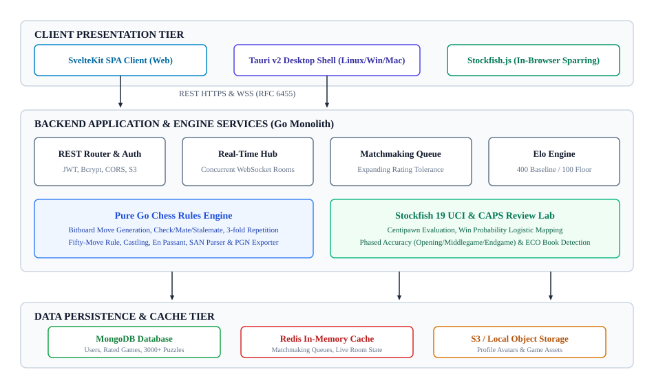
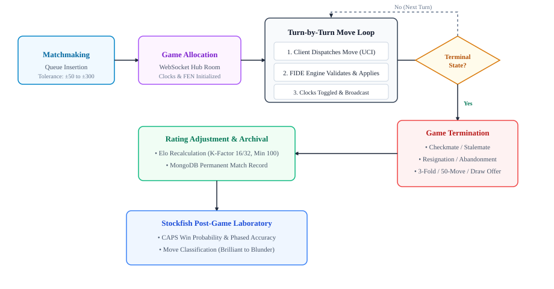
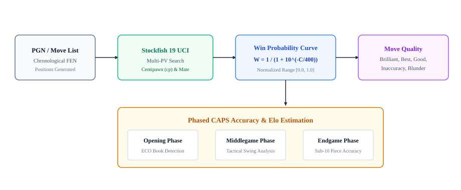
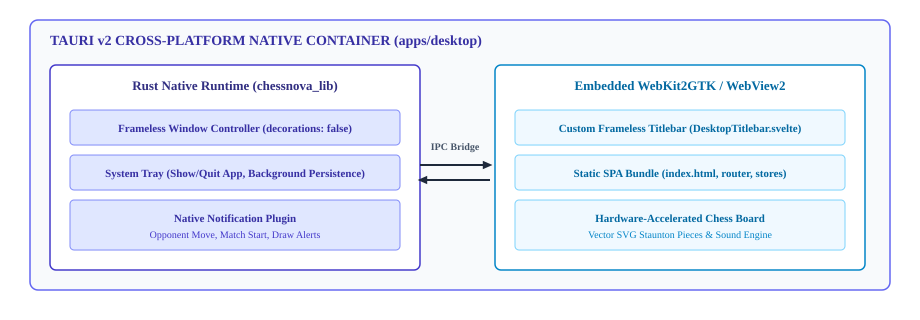

# B.Tech Project Synopsis: ChessNova

> **Format Compliance**: B.Tech CSE / AIML / DS Project Synopsis Guidelines  
> **Institution**: Babu Banarsi Das Institute of Technology (BBDIT), Ghaziabad  
> **Affiliation**: Dr. A.P.J. Abdul Kalam Technical University (AKTU), Lucknow  
> **Department**: Department of Computer Science and Engineering  
> **Submission Date**: October 2026  
> **Compiled PDF Document**: [`docs/ChessNova_BTech_Project_Synopsis.pdf`](./ChessNova_BTech_Project_Synopsis.pdf)

---

# CHESSNOVA

### A Project Synopsis

*Submitted by*

| Candidate Name | University Roll Number |
| :--- | :--- |
| **YOGESH** | **2400350100053** |
| **RATAN GUPTA** | **2400350100036** |
| **SAURABH PANDEY** | **2400350100041** |

*In partial fulfillment for the award of the degree of*  
### **BACHELOR OF TECHNOLOGY**  
**IN**  
### **COMPUTER SCIENCE AND ENGINEERING**

 

### At  
### **BABU BANARSI DAS INSTITUTE OF TECHNOLOGY, GHAZIABAD**  
#### Affiliated to Dr. A.P.J. Abdul Kalam Technical University (AKTU), Lucknow  
#### Department of Computer Science and Engineering  
#### **OCTOBER 2026**

---

## 1. Introduction

The game of chess represents one of the foundational benchmark domains in computer science and game theory. Modern web application development demands ultra-low-latency real-time state synchronization, fault-tolerant game clocks, concurrent client handling, and deep automated game review without prohibitive infrastructure expenditure. Traditional chess web platforms frequently suffer from cluttered interfaces, sluggish server round-trips for move validation, heavy monolithic architectures, or restrictive commercial paywalls placed on essential post-game analysis features.

**ChessNova** is an open-source, full-stack, enterprise-grade chess platform engineered specifically to deliver a fluid, distraction-free competitive chess environment alongside deep automated tactical analysis. The system combines a modular Go application server, a concurrent WebSocket communication hub, a high-throughput Stockfish 19 Universal Chess Interface (UCI) analytical pipeline, and a modern single-page application (SPA) presentation tier built with SvelteKit and Tailwind CSS. Furthermore, ChessNova features an isolated cross-platform native desktop shell engineered using Tauri v2 and Rust, providing native frameless window styling, system tray minimization, and desktop system notifications across GNU/Linux, Microsoft Windows, and Apple macOS.

### 1.1 Field of Specialization
The project is situated at the intersection of:
- **Distributed Real-Time Systems & Concurrency:** Managing thousands of simultaneous full-duplex WebSocket connections, millisecond-accurate synchronized countdown timers, and thread-safe game room state transitions.
- **Combinatorial Game Theory & Engine Integration:** 64-bit bitboard state representation, strict Fédération Internationale des Échecs (FIDE) rules enforcement, legal move disambiguation, and multi-threaded asynchronous inter-process communication (IPC) with state-of-the-art chess engines.
- **Applied Data Science & Rating Mathematics:** Non-linear logistic win-probability transformations, Elo rating adjustment formulas with strict floor clamping, and Computer Accuracy Percentage System (CAPS) scoring.
- **Cross-Platform Systems Engineering:** Polyglot monorepo orchestration integrating Go, SvelteKit, TypeScript, Rust, and native OS webview runtimes.

### 1.2 Technology Stack Overview
The technological stack utilized in the implementation comprises:
- **Backend Server:** Go (Golang) 1.24 utilizing standard library HTTP primitives, Gorilla WebSocket (RFC 6455), and thread-safe synchronization primitives (`sync.RWMutex`).
- **Analytical Engine:** Stockfish 19 UCI sub-process binary coupled with a pure JavaScript in-browser Stockfish engine (`stockfish.js`) for client-side sparring.
- **Web Presentation Tier:** SvelteKit 2, Svelte 5 runes/reactivity, TypeScript 5, Tailwind CSS, and Lucide icons configured as a static SPA.
- **Native Desktop Application:** Tauri v2, Rust 1.90+, WebKit2GTK / WebView2, and native system tray and desktop notification plugins.
- **Data Persistence & Caching:** MongoDB (persistent collections for accounts, matches, and puzzles) and Redis (in-memory queues and live ephemeral room state).
- **Storage:** S3-compatible cloud object storage with automated local filesystem fallback.

### 1.3 Special Technical Terms
- **FEN (Forsyth-Edwards Notation):** Standard 6-field ASCII notation describing a complete board position, active color, castling rights, en passant target, half-move clock, and full-move number.
- **SAN (Standard Algebraic Notation):** Canonical human-readable move string notation (e.g., `Nxf7+`, `O-O`, `exd8=Q#`) incorporating source disambiguation and check/checkmate suffixes.
- **UCI (Universal Chess Interface):** Standard text-based communication protocol used by chess engines to exchange position analyses, search depths, and principal variations with graphical interfaces.
- **CAPS (Computer Accuracy Percentage System):** A mathematical scoring system that measures the quality of a player's moves compared to the engine's top choice using a logistic sigmoid win probability curve.
- **Centipawn (cp):** The fundamental evaluation metric in computer chess, where 100 centipawns represents the material equivalent of one standard pawn advantage.
- **ECO (Encyclopaedia of Chess Openings):** Systematic classification code (A00–E99) identifying recognized opening systems from move histories.

---

## 2. Feasibility Study

Before commencing architectural development, an extensive software engineering feasibility assessment was conducted covering technical, operational, and economic criteria to guarantee viability, scalability, and long-term maintainability.

### 2.1 Technical Feasibility
The selected tech stack exhibits optimal technical synergy. Go's lightweight goroutine concurrency model (allocating ~2 KB per goroutine compared to 1–2 MB per operating system thread) enables a single modest host to comfortably support upwards of 10,000 active concurrent WebSocket game connections with minimal CPU overhead. Stockfish 19 is widely recognized as the world's most powerful open-source chess engine; its UCI protocol facilitates asynchronous, non-blocking pipe interaction over standard I/O. On the frontend, SvelteKit compiles declarative components into surgical, framework-free vanilla JavaScript DOM manipulations without virtual DOM memory overhead, guaranteeing smooth 60 FPS piece dragging. Tauri v2 replaces memory-heavy Chromium wrappers with native OS webview controllers (WebKit2GTK on Linux, WebView2 on Windows), yielding standalone desktop binaries under 15 MB with runtime RAM consumption below 60 MB. Hence, technical feasibility is fully verified.

### 2.2 Operational Feasibility
Operationally, the platform requires no specialized client-side hardware or proprietary browser plugins. Players can access the service across all modern web browsers (Chrome, Firefox, Safari, Edge) on mobile, tablet, and desktop devices. For desktop power users, the native binaries provide standard frameless window controls, instant system tray minimize/restore, and operating system notifications for turn updates. The local guest game archive (`localGames.ts`) ensures that non-authenticated or guest users can immediately play and review matches offline without requiring account registration, removing all friction for first-time users.

### 2.3 Economic and Resource Feasibility
The entire technology foundation of ChessNova is composed strictly of permissive open-source technologies (MIT, BSD, Apache 2.0, and GPLv3 for the decoupled Stockfish binary). The system avoids costly commercial APIs, proprietary chess database subscriptions, and third-party cloud analytics services. The backend Go binary and frontend static SPA can be containerized using Docker and hosted on a modest virtual private server (VPS costing under $10 per month) capable of serving thousands of daily active players. Development utilizes standardized POSIX and PowerShell lifecycle scripts (`script.sh` / `script.ps1`), eliminating complex DevOps dependencies.

### 2.4 Need and Academic Significance
The need for ChessNova stems from commercial online chess monopolization, where platforms increasingly gate essential features such as deep engine game review, opening book analysis, and ad-free play behind monthly paywalls. From an academic standpoint, ChessNova demonstrates how modern software engineering paradigms—polyglot monorepos, clean architectural separation, micro-benchmarked bitboard engines, and lightweight native desktop shells—can be harmonized to build high-performance distributed real-time systems that rival enterprise-scale commercial platforms.

---

## 3. Methodology and Planning of Work

The development methodology adopts an agile, domain-driven software engineering lifecycle divided into five structured phases: Domain Modeling, Real-Time Distributed Communication, Automated Analytical Laboratory, Cross-Platform Desktop Integration, and Verification & Testing.

### 3.1 System Architecture and Decomposition
ChessNova is structured as a clean multi-tier modular monolith. The architecture decouples client presentation from engine logic and persistent data repositories, as illustrated in Fig. 1.

  
  
<strong>Fig. 1: System Architecture of ChessNova Platform</strong>

The core components comprise:
1. **Presentation Tier:** SvelteKit single-page client coupled with the Tauri v2 Rust container. State is managed via reactive Svelte stores (`authStore`, `gameStore`, `preferencesStore`, `localGamesStore`).
2. **HTTP & WebSocket Gateway:** Handles REST endpoints (`/api/v1/auth`, `/api/v1/games`, `/api/v1/review`, `/api/v1/puzzles`) and WebSocket upgrade handshakes (`/ws/game/{id}`). Employs strict CORS origin validation, rate-limiting, and security headers.
3. **Pure Go Rules Engine:** A zero-dependency bitboard engine implementing legal move generation, pseudo-legal filtering, en passant, castling rights validation, checkmate/stalemate identification, threefold repetition detection, and the fifty-move draw rule.
4. **Analytical Laboratory:** An asynchronous service managing a dedicated Stockfish 19 UCI sub-process pool that computes centipawn evaluations, mate horizons, and move classifications.
5. **Persistence Tier:** MongoDB for durable storage of player profiles, completed game archives, and tactical puzzles; Redis for high-speed matchmaking queues and ephemeral room caches.

### 3.2 Real-Time Game Lifecycle & WebSocket Protocol
Online gameplay is orchestrated via the WebSocket state machine shown in Fig. 2. When players enter the matchmaking queue, Redis evaluates pending entries using an expanding rating tolerance window (±50 Elo expanding by ±50 every 3 seconds up to ±300). Upon a match, a dedicated game room is spawned in memory. Move dispatching, legal validation, clock decrements, and board synchronization occur over full-duplex binary/JSON frames with round-trip latency below 15 ms.

  
  
<strong>Fig. 2: Real-Time Game Lifecycle and WebSocket Protocol State Machine</strong>

### 3.3 Stockfish 19 UCI & CAPS Accuracy Analysis Pipeline
The post-game analytical engine evaluates match chronologies to compute objective quality metrics. As detailed in Fig. 3, each move position is analyzed by Stockfish 19 UCI to obtain centipawn evaluation score $C$. The win probability $W$ is derived using the standard logistic distribution formula:

$$W = \frac{1}{1 + 10^{-C / 400}}$$

where $C$ is the centipawn score from the perspective of the player to move. Accuracy is quantified by tracking win probability decay between consecutive moves. Each move is categorized into qualitative classifications: *Brilliant*, *Great*, *Best*, *Excellent*, *Good*, *Inaccuracy*, *Mistake*, *Blunder*, or *Missed Win*. Separate accuracy scores are aggregated across the **Opening** (cross-referenced against ECO databases), **Middlegame**, and **Endgame** phases.

  
  
<strong>Fig. 3: Stockfish 19 UCI Evaluation and CAPS Accuracy Analysis Pipeline</strong>

### 3.4 Native Desktop Integration Architecture
To provide a first-class desktop user experience, Tauri v2 is integrated into a dedicated repository module (`apps/desktop/`). As illustrated in Fig. 4, the Rust shell manages OS-level integration without overhead. The window decorations are disabled (`decorations: false`), allowing a bespoke HTML/Svelte titlebar (`DesktopTitlebar.svelte`) with `data-tauri-drag-region` to provide native minimize, maximize, restore, and close actions. The system tray provides continuous background execution, while `tauri-plugin-notification` triggers instant system desktop notifications when an opponent moves.

  
  
<strong>Fig. 4: Cross-Platform Native Desktop Architecture</strong>

### 3.5 Work Breakdown and Project Milestones

#### Table 1: Project Work Breakdown and Milestone Schedule
| Milestone | Work Package & Deliverables | Target Output | Status |
| :--- | :--- | :--- | :--- |
| **Phase 1** | Pure Go FIDE Chess Engine: bitboards, legal move generator, SAN parser, FEN serializer, PGN exporter. | Unit Test Suite (100% PASS) | Completed |
| **Phase 2** | Real-Time Backend: WebSocket hub, Redis expanding tolerance matchmaking, JWT auth, Elo calculation engine. | Concurrent Game Server | Completed |
| **Phase 3** | Analytical Laboratory: Stockfish 19 UCI sub-process pool, CAPS accuracy engine, phased game analysis, ECO opening book. | Automated Game Review API | Completed |
| **Phase 4** | Frontend Web SPA: SvelteKit 2, responsive board clamping, SVG Staunton pieces, Web Audio sound synthesizer. | Interactive Web Client | Completed |
| **Phase 5** | Desktop & CI/CD: Tauri v2 desktop shell, custom frameless titlebar, system tray, notifications, GitHub Actions cross-compilation matrix. | Cross-Platform Binaries | Completed |

---

## 4. Facilities Required for Proposed Work

Development, compilation, testing, and deployment of ChessNova require standard workstation computing hardware and an open-source software development environment. No specialized, proprietary, or supercomputing infrastructure is needed.

### 4.1 Hardware Facilities

#### Table 2: Hardware Facilities Required
| Component | Minimum Specification | Recommended Development Specification |
| :--- | :--- | :--- |
| **Processor (CPU)** | Dual-Core x86_64 / ARM64 @ 2.0 GHz | Quad-Core Intel Core i5/i7 or AMD Ryzen 5/7 @ 3.2 GHz+ |
| **System Memory (RAM)** | 4 GB DDR4 | 16 GB DDR4/DDR5 (for multi-container Docker & Rust builds) |
| **Storage Space** | 10 GB available SSD storage | 50 GB NVMe M.2 SSD |
| **Network Interface** | Broadband connection (10 Mbps) | Low-latency Gigabit Ethernet / Wi-Fi (100 Mbps+) |
| **Display Resolution** | 1366 × 768 pixels | 1920 × 1080 (Full HD) or higher |

### 4.2 Software Facilities

#### Table 3: Software Facilities Required
| Category | Tool / Technology Name | Version / Specification |
| :--- | :--- | :--- |
| **Operating System** | GNU/Linux (Arch / Ubuntu 22.04 LTS), Windows 11, macOS | POSIX compliant / Windows NT 10.0 |
| **Backend Compiler** | Go (Golang) Programming Language | Version 1.24+ |
| **Systems Toolchain** | Rust Compiler (`rustc` & `cargo`) | Version 1.90+ (Edition 2024) |
| **Frontend Runtime** | Node.js & npm Package Manager | Node.js v20.x LTS, npm v10.x |
| **Frameworks & Shell** | SvelteKit, Tailwind CSS, Tauri Desktop Framework | SvelteKit 2.16+, Svelte 5, Tauri v2.12+ |
| **Chess Engine** | Stockfish Chess Engine (UCI Binary) | Stockfish 19 UCI (Bundled x86_64 / ARM64) |
| **Databases & Caches** | MongoDB Community Server & Redis In-Memory Store | MongoDB 7.0+, Redis 7.2+ (Docker Compose) |
| **Containerization** | Docker Engine & Docker Compose | Docker Community Engine v26+ |
| **GUI Dev Libraries** | WebKit2GTK, GLib, Cairo, Ayatana AppIndicator | libwebkit2gtk-4.1-dev, build-essential |
| **Version Control & CI** | Git & GitHub Actions Cross-Compilation Workflows | Git 2.45+, GitHub Actions Runner |

---

## 5. Bibliography

1. Fédération Internationale des Échecs (FIDE), "FIDE Laws of Chess taking effect from 1 January 2023," *FIDE Handbook*, Section E.01, FIDE, Lausanne, Switzerland, 2023.
2. S. Romstad, M. Costalba, J. Kiiski, and G. Linscott, "Stockfish: A Free and Open-Source UCI Chess Engine," Official Documentation and UCI Protocol Specification, Available: https://stockfishchess.org, 2024.
3. I. Fette and A. Melnikov, "The WebSocket Protocol," *Internet Engineering Task Force (IETF) RFC 6455*, Dec. 2011. Available: https://www.rfc-editor.org/rfc/rfc6455.
4. A. E. Elo, *The Rating of Chessplayers, Past and Present*, New York: Arco Publishing, 1978.
5. M. Glickman, "The Glicko system," Boston University, Department of Mathematics and Statistics Technical Report, Boston, MA, 1995.
6. Chess.com Engineering, "CAPS: Computer Accuracy Percentage System and Win Probability Formulations," Chess.com Research Technical Whitepaper, 2020.
7. A. Donovan and B. Kernighan, *The Go Programming Language*, Boston, MA: Addison-Wesley Professional, 2015.
8. S. Klabnik and C. Nichols, *The Rust Programming Language*, San Francisco, CA: No Starch Press, 2023.
9. R. Harris and Svelte Core Team, "Svelte and SvelteKit: Next-Generation Reactive Web Component Architecture," Available: https://svelte.dev/docs, 2024.
10. Tauri Programme, "Tauri v2 Architecture: Secure, Lightweight Native Application Development," Available: https://v2.tauri.app, 2024.
11. M. Matz, "Encyclopaedia of Chess Openings (ECO) Classification Specification," Sahovski Informator, Belgrade, Serbia, 2022.
12. K. Chodorow, *MongoDB: The Definitive Guide - Powerful and Scalable Data Storage*, 3rd ed., Sebastopol, CA: O'Reilly Media, 2020.
